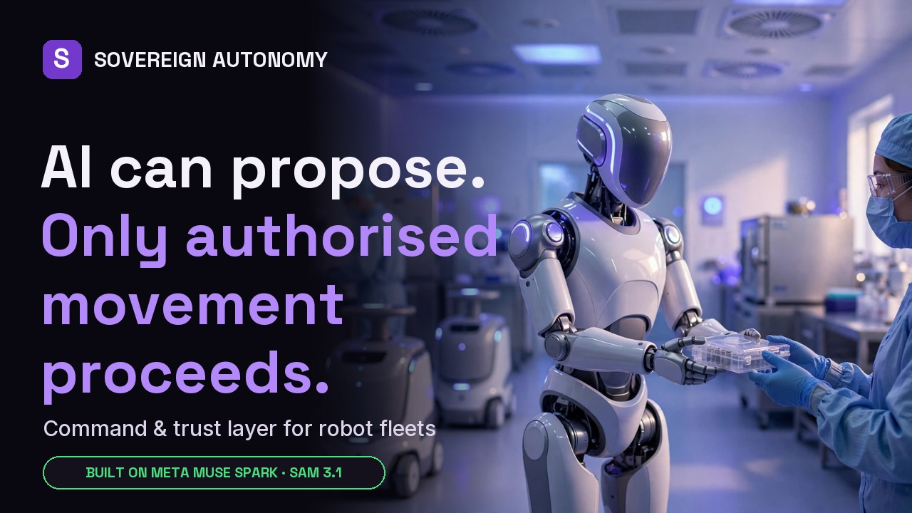
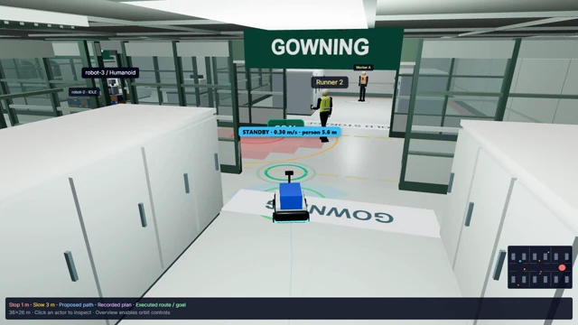
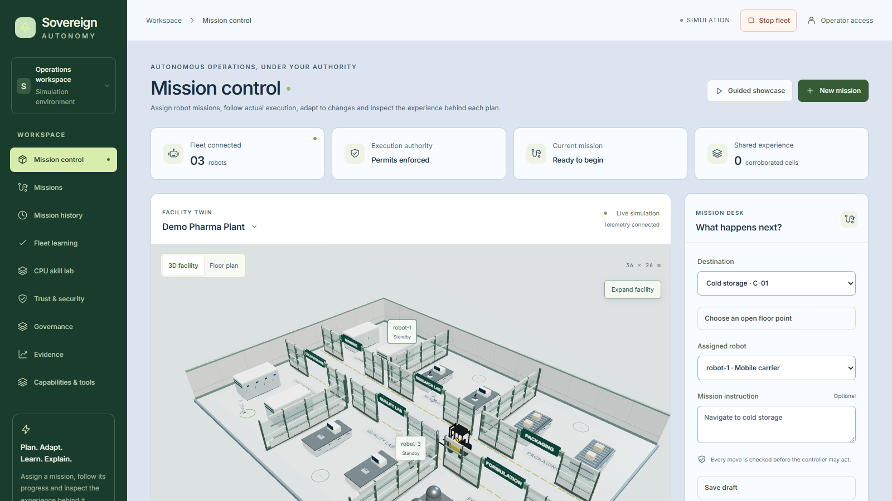
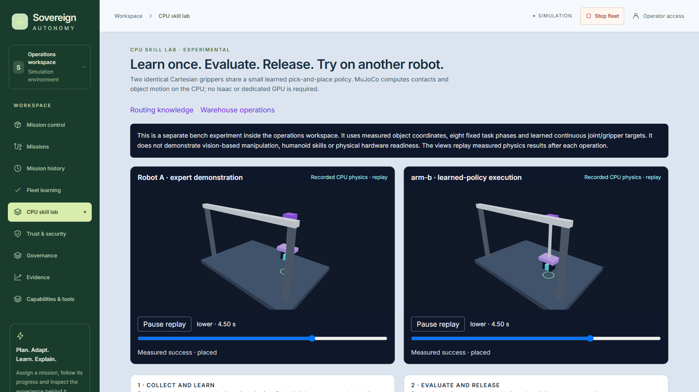
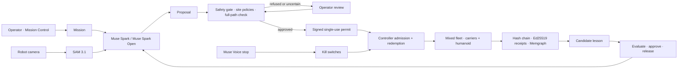

# Sovereign Autonomy

[](LICENSE)
[](backend/pyproject.toml)
[](frontend/package.json)
[](#built-on-meta)

**The command and trust layer for robot fleets.**
AI can propose. Only authorised movement can proceed.

Sovereign Autonomy coordinates robot missions, governs execution, manages approved
fleet knowledge and preserves evidence of what happened. It is built for mixed fleets
(mobile carriers and humanoids) working beside people, starting with pharmaceutical
cleanrooms.

**Live:** https://204-12-178-126.sslip.io · [Mission Control](https://204-12-178-126.sslip.io/mission-control) ·
[How it works](https://204-12-178-126.sslip.io/how-it-works) · [Fleet learning](https://204-12-178-126.sslip.io/learning)

**Project repository:** [github.com/othnielObasi/sovereign-autonomy](https://github.com/othnielObasi/sovereign-autonomy)

**Demo video (2:45):** [youtu.be/Kak8teTVHSA](https://youtu.be/Kak8teTVHSA)

[](https://youtu.be/Kak8teTVHSA)

**Recorded mission:** [Watch the deployed simulator recording](https://204-12-178-126.sslip.io/#experience) ·
[Recording provenance](frontend/public/home/mission-film/provenance.json).

Built for the **Meta Global AI Developer Hackathon**, Startup track, **Push the Frontier**.
This extends an existing project; [the contribution declaration below](#hackathon-contribution-declaration)
separates the earlier foundation from the hackathon additions.



*Frame from the deployed 3D simulator recording on 4 November 2026. This shows the facility and robot-eye view, not a physical robot or independent proof of a completed stop. [Source run and chapter timestamps](frontend/public/home/mission-film/provenance.json).*

[Try the demo](#try-the-demo) · [Contributions](#hackathon-contribution-declaration) ·
[Capabilities](#core-capabilities) · [Evidence](#measured-evidence-and-validation) ·
[Architecture](#architecture) · [Local setup](#quick-start-local) · [Limitations](#scope)

---

## Try the demo

1. Open [Mission Control](https://204-12-178-126.sslip.io/mission-control). Inspect the facility, select a robot and choose a destination. Launch requires the permissions enabled on the deployment.
2. Follow the robot and inspect its decision trail: proposed action, gate result, permit and controller admission. A hold or refusal should explain why movement cannot proceed.
3. Open [Fleet learning](https://204-12-178-126.sslip.io/learning) to inspect candidate lessons, evaluation, exact-version release and recipient compatibility. Approval, release and stop reset require operator sign-in.
4. For a read-only walkthrough, use [How it works](https://204-12-178-126.sslip.io/how-it-works) and the homepage's recorded mission. Recorded footage does not control the live fleet.

The public demo shares one simulated facility, permits one mission at a time, limits missions to seven minutes and caps paid model calls. A busy or stopped fleet may prevent a new launch. Judge credentials belong in the private submission form, never in this README.

## Hackathon contribution declaration

**Sovereign Autonomy builds on the earlier MoveProof project. We do not claim the existing policy gate, audit foundation or earlier learning as new hackathon work.**

| Origin | Scope | Where to inspect |
| --- | --- | --- |
| Pre-existing foundation, before 26 October 2026 | Deterministic policy gate; decision receipts and event chain; task-drift guard; adaptive tuning and cross-run learning; 3D warehouse twin (first committed 22 Oct); Tavily site intelligence (22 Oct); rule workflows and benchmarking | [MoveProof](https://github.com/othnielObasi/moveproof), [contribution declaration](docs/HACKATHON_SUBMISSION.md#built-during-the-hackathon-versus-the-existing-foundation) |
| Hackathon additions after the baseline | Meta planning, SAM perception and voice stop; controller-enforced permits and recovery; mixed-fleet coordination; signed/scoped experience and operator-released learning; pharmaceutical cleanroom facility and 3D realism pass; Memgraph integration and deployment | [Changelog](CHANGELOG.md), [baseline comparison](https://github.com/othnielObasi/sovereign-autonomy/compare/3738a53...cd5fa57), [submission detail](docs/HACKATHON_SUBMISSION.md) |
| Governed skill transfer (hackathon) | CPU pick-and-place learning, held-out evaluation and governed same-profile recipient execution; live at [/skills](https://204-12-178-126.sslip.io/skills) | [Implementation](https://github.com/othnielObasi/sovereign-autonomy/commit/64a5bbd), [grant fix](https://github.com/othnielObasi/sovereign-autonomy/commit/b786a13), [CPU lab scope and method](docs/CPU_SKILL_LAB.md) |

Baseline `3738a53` was assembled on **1 November 2026** from the earlier MoveProof codebase; its timestamp is an import date. Original creation dates are in the [MoveProof history](https://github.com/othnielObasi/moveproof/commits/main) (for example the 3D twin and Tavily integration, both 22 October 2026). The linked comparison ends at a fixed revision; future commits are not automatically hackathon work. The guide's build period is **27 October–4 November 2026**, with a deadline of **4 November at 21:00 EST (5 November at 02:00 UTC)**; work attributed to 26 October should be identified separately rather than assumed eligible.

## Why it exists

Robot fleets are moving into shared workplaces. The models that plan their moves can be
wrong, confused or manipulated, and in a cleanroom one bad move is an injury, a lost
batch or a failed audit. Sovereign Autonomy puts a deterministic, verifiable authority
between every AI proposal and every movement, keeps humans in command, and records a
signed trail an auditor can check.

**Who benefits:** operations teams assigning robot work, safety leads controlling execution, and quality teams investigating decisions. Pharmaceutical cleanrooms are the starting scenario; hospitals, logistics and manufacturing are potential applications, not validated customer deployments.

## Core capabilities

| Capability | Implemented behavior | Evidence / scope |
| --- | --- | --- |
| Mission intelligence | Natural-language plans, robot assignment, route generation, replanning and task-drift checks | [Mission runtime](backend/app/services/run_service.py); simulated navigation |
| Governed execution | Site policies check proposals; signed, expiring single-use permits are checked at controller admission | [Authority](backend/app/autonomy), [safety case](docs/SAFETY_CASE.md) |
| Human oversight and stops | Operator reviews, interventions, scoped kill switches, stop-only voice input and authenticated reset | [Operator controls](docs/OPERATOR_CONTROLS.md) |
| Mixed-fleet coordination | Independent robot profiles, peer obstacles and path reservations | [Capability audit](docs/CAPABILITY_AUDIT.md); no humanoid balance or manipulation control |
| Perception and environment response | Camera segmentation, floor projection, sensor cross-checks and caution zones | [Perception service](backend/app/services/perception.py); simulated cameras and geometry |
| Governed fleet knowledge | Corroboration, poisoning checks, evaluation, exact-version approval/release, compatibility, expiry and withdrawal | [Release boundary](docs/LEARNING_RELEASE_BOUNDARY.md); route advice does not grant motion authority |
| Agentic orchestration and memory | Tool-based planning path, decision feedback, scoped memory and operational graph queries | [Agent service](backend/app/services/agent_service.py), [Memgraph](docs/MEMGRAPH.md); available paths depend on configuration |
| Evidence and recovery | Signed receipts, hash-chain verification, replay, checkpoints, restart reconciliation and signed backups | [Traceability](docs/TRACEABILITY.md), [runbook](docs/RUNBOOK.md) |
| Rule and robustness evaluation | Rule proposals, replay/benchmark evaluation, approval, rollback and adversarial scenarios | [Capability audit](docs/CAPABILITY_AUDIT.md); reports are not certification |
| CPU skill learning and transfer | Learned actuator targets, six held-out trials, negative control and approved execution on a compatible simulated arm | [CPU skill lab](docs/CPU_SKILL_LAB.md); live at /skills; fixed task phases, simulated arms |

### Screenshots (live deployment, 5 November 2026)

**Mission Control:** pharmaceutical facility twin, fleet status, permits enforced, mission desk.



**CPU skill lab:** Robot A's expert demonstration beside arm-b executing the learned, released policy in MuJoCo physics.



## A mission, end to end

1. **Assign.** An operator assigns a mission, for example *"Carry the QC samples to packaging"* for the humanoid.
2. **Plan.** Meta **Muse Spark** plans from the site map, the robot's profile and its own camera frame. **SAM 3.1** segments people in view; they become temporary keep-out zones.
3. **Check.** Every proposed move passes the safety gate: human proximity and clearance, obstacle and full-path clearance, speed and model confidence.
4. **Permit.** Only an approved move is signed into an expiring, single-use permit. The robot's controller redeems it with the backend before moving; a replayed, expired or revoked permit is refused.
5. **Respond.** If a worker is too close, the move is refused and the robot stops, retreats or replans. Low confidence escalates to an operator; on approval a fresh permit is issued.
6. **Stop.** Kill switches act on one robot, a mission, an agent or the whole fleet, by button or by voice (**Muse Voice Transcribe**). Stops never depend on the planner; only a signed-in operator can release them.
7. **Learn.** Signed observations become a candidate lesson only when corroborated by two robots. The lesson is evaluated, approved by an operator, released by exact version to compatible robots only (carriers yes, humanoid no), and expires within 24 hours.
8. **Prove.** Every decision is hash-chained and receipted with Ed25519, linked in a Memgraph evidence graph, and traced end to end.

## Built on Meta

| Model | Role in the system |
| --- | --- |
| **Muse Spark 1.3** | Mission planner: route and next-step proposals from map + robot camera. Always treated as untrusted input to the gate. |
| **Muse Spark Open** (open weights, via Baseten) | Step proposals and planner fallback, so the fleet does not depend on one endpoint; deployable in a customer's own environment. |
| **SAM 3.1** | Camera segmentation feeds floor-projected caution and sensor cross-checks. One recorded simulator run matched 35 objects with 2 cm median error; this is not a general accuracy claim. |
| **Muse Voice Transcribe** | Hands-free stop-only input. One synthetic-speech test took 1,445 ms to transcribe, followed by 3.38 ms authority revocation; the latter is not end-to-end spoken-stop latency. |
| **Muse Image** | Product and demo imagery. |

Without model credentials, navigation falls back to a labelled deterministic planner; the gate and controller admission still apply.

## Architecture



| Layer | Technology |
| --- | --- |
| API and mission runtime | FastAPI, SQLAlchemy, Alembic, Postgres |
| Routing | NetworkX over the site graph, partitions and keep-out zones |
| Prompt-injection defence | Canary tripwires in model context; a model that obeys planted text is caught |
| Recovery | Checkpoints and in-doubt reconciliation: no move is repeated after an interruption |
| Evidence | Hash-chained events, Ed25519 receipts, optional Memgraph evidence graph |
| Observability | LangSmith / OpenTelemetry traces, Prometheus metrics at `/api/metrics` |
| Workspace | Next.js, shared Three.js 3D facility twin |
| Robots | Live simulator (`sim/warehouse_sim`) with a controller journal |
| Production | Docker Compose, Caddy HTTPS, Nebius (US), signed backups |

## Repository

| Path | Purpose |
| --- | --- |
| `backend/app/` | FastAPI, mission runtime, governance, authority, learning, evidence |
| `backend/app/policies/` | Safety policies, site map, path and retreat logic |
| `backend/bench/` | Site layouts (pharma, warehouse, factory) and benchmark harness |
| `sim/warehouse_sim/` | Navigation simulator and controller journal |
| `frontend/` | Next.js workspace and 3D facility |
| `frontend/public/` | Public homepage, How it works and recorded evidence |
| `deploy/` | Production Compose, Caddy, deploy script |
| `docs/` | Architecture, API, safety case, operations, validation |

## Quick start (local)

Requirements: Docker with Compose (or Python 3.11+ and Node.js 20+). No GPU needed;
the browser needs WebGL for the 3D views.

```sh
git clone https://github.com/othnielObasi/sovereign-autonomy.git
cd sovereign-autonomy
cp .env.example .env        # set PERMIT_SECRET (32+ random chars); add model keys if you have them
docker compose up -d --build
```

| Service | Address |
| --- | --- |
| Mission Control | http://localhost:3000/mission-control |
| Fleet learning | http://localhost:3000/learning |
| Backend health | http://localhost:8080/health |
| API docs | http://localhost:8080/docs (when enabled) |

The root Compose file is for development. See [BUILD.md](docs/BUILD.md) for native multi-process setup.

## Production deployment

`deploy/docker-compose.prod.yml` runs Caddy (HTTPS), the backend, the frontend production
build, Postgres, the simulator and optional Memgraph on a private network. Create the
ignored `deploy/.env.production`:

| Variable | Purpose |
| --- | --- |
| `SITE_DOMAIN` | Hostname pointing at the host (ports 80/443 open) |
| `ENVIRONMENT=production` | Enables production config validation |
| `JWT_SECRET`, `SIM_TOKEN`, `PERMIT_SECRET` | Independent random secrets; permit secret shared with the simulator |
| `POSTGRES_PASSWORD` | Database password (URL-safe) |
| `AUTH_REQUIRED=true`, `ALLOW_DEV_TOKENS=false` | Enforce authentication |
| `AUTH_ACCOUNTS` | Hashed viewer/operator/admin accounts from `scripts/add_account.py` (escape `$` as `$$` for Compose) |
| `RUN_MIGRATIONS_ON_START=true` | Apply Alembic migrations at startup |
| `SITE_LAYOUT=pharma` | Cleanroom layout (`warehouse`, `factory` also available) |
| `RECEIPT_SIGNING_KEY_FILE` | Persistent, protected receipt signing key |
| `MODEL_API_KEY`, `BASETEN_API_KEY` | Meta Model API and Muse Spark Open (never commit) |
| `TAVILY_API_KEY`, LangSmith keys | Optional site lookup and tracing |

```sh
docker compose -f deploy/docker-compose.prod.yml --env-file deploy/.env.production up -d --build
```

Meta's Model API availability is region-dependent; the reference deployment runs in the
US (Nebius us-north1). Before exposing a deployment, verify health, operator sign-in,
refusal of unauthorised writes, controller admission, stop/reset, evidence verification
and backup/restore.

**Persistence and recovery.** Persist Postgres, `backend_data`, `controller_data`, signing
keys and memory anchors. Signed backups: `python -m app.ops.backup`. Interrupted runs
reconcile before continuing. Software stops complement, and do not replace,
safety-rated hardware controls on physical robots.

## Measured evidence and validation

| Recorded observation | Result | Interpretation |
| --- | --- | --- |
| Deployed Meta-planned mission, 4 Nov | 203 decisions; 182 permit events; Muse Spark and Spark Open named in the record | Shows the model/authority workflow in one simulated run, not 182 independently verified successful moves |
| SAM cross-checks in that run | 41 checks; 35 matched objects; median error 0.02 m, p90 0.19 m, maximum 0.77 m; one missed-hazard verdict | Sensor disagreement remains visible; median error alone hides important failures |
| Event-chain verification for that run | 1,222 entries; stored verification result valid | A separate homepage recording has 1,018 entries; these are different runs |
| Voice stop | 1,445 ms transcription; 3.38 ms revocation after transcription; unauthenticated reset refused | One synthetic-speech test; not a safety latency guarantee |
| Fleet lesson release | Version evaluated, approved and released; two carrier profiles accepted and humanoid profile excluded | Demonstrates scoped release eligibility, not general cross-platform transfer |
| Latest focused local regression run | 108 passed, 4 skipped; frontend TypeScript passed | CPU lab, learning release, agent memory, planner lessons, integrity and graph tests; not a full-suite count or deployment test |
| Skill transfer on production, 5 Nov | Trained; 6/6 held-out placements; approved and released; installed on arm-b; arm-c refused (profile mismatch); signed grant executed once and placed the object; replayed grant refused | One recorded run on the deployed CPU lab |

The first five rows come from [recorded deployed API evidence](frontend/public/home/evidence/live-validation-2026-11-04.json). They are dated observations, not continuously refreshed status. The focused regression run was performed on the local code committed as `64a5bbd`. Earlier broad-suite counts belong to their respective revisions and should not be combined with this focused run.

Reproduce the focused checks:

```sh
cd backend
python -m pytest tests/test_cpu_skills.py tests/test_learning_release.py tests/test_agent_memory_scope.py tests/test_planner_lessons.py tests/test_lesson_integrity.py tests/test_operational_graph.py -q
```

For the full backend suite and frontend checks:

```sh
# From the repository root:
python -m pytest backend/tests -q
cd frontend
npx tsc --noEmit
npm run build
```

Run the backend and frontend commands from their respective directories. CPU physics tests require the optional `skills` extra; see the [CPU lab setup](docs/CPU_SKILL_LAB.md).

Live validation on the production deployment (4 Nov 2026) covered Muse Spark planning,
SAM 3.1 detection, voice stop, kill switch and operator reset, fleet-lesson release,
Memgraph, LangSmith tracing and backups:
[evidence](frontend/public/home/evidence/live-validation-2026-11-04.json).

## Scope

The robots run in a simulator today; hardware adapters and site safety validation are
the next step toward physical deployment.

**Governed skill transfer** ([CPU skill lab](docs/CPU_SKILL_LAB.md), MuJoCo physics): Robot A
learns a pick-and-place skill from twelve demonstrations; the skill is tested on held-out
positions (with a no-grip ablation that must fail), approved and released by exact
digest, installed on compatible Robot B, refused for incompatible Robot C, and executed
only under a signed single-use grant. It is enabled on the live deployment and disabled by
default elsewhere (`SKILL_LAB_ENABLED=true` with the `skills` extra).
What was built during the hackathon, as distinct from the earlier policy-gate
foundation, is set out in [HACKATHON_SUBMISSION.md](docs/HACKATHON_SUBMISSION.md).

## Documentation

- [Architecture](docs/architecture.md) · [API](docs/api.md) · [Operator controls](docs/OPERATOR_CONTROLS.md)
- [Safety case](docs/SAFETY_CASE.md) · [Traceability](docs/TRACEABILITY.md) · [Capability audit](docs/CAPABILITY_AUDIT.md)
- [Learning release boundary](docs/LEARNING_RELEASE_BOUNDARY.md) · [Poisoning defences](docs/LEARNING_POISONING_DEFENSES.md)
- [Memgraph](docs/MEMGRAPH.md) · [Runbook](docs/RUNBOOK.md) · [Changelog](CHANGELOG.md)

## License

[MIT](LICENSE)
