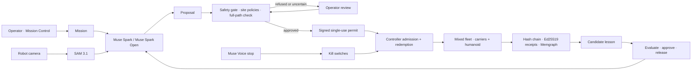

# Sovereign Autonomy

**The command and trust layer for robot fleets.**
AI can propose. Only authorised movement can proceed.

Sovereign Autonomy coordinates robot missions, governs execution, manages approved
fleet knowledge and preserves evidence of what happened. It is built for mixed fleets
(mobile carriers and humanoids) working beside people, starting with pharmaceutical
cleanrooms.

**Live:** https://204-12-178-126.sslip.io · [Mission Control](https://204-12-178-126.sslip.io/mission-control) ·
[How it works](https://204-12-178-126.sslip.io/how-it-works) · [Fleet learning](https://204-12-178-126.sslip.io/learning)

[Architecture](docs/architecture.md) · [API](docs/api.md) · [Safety case](docs/SAFETY_CASE.md) ·
[Capability audit](docs/CAPABILITY_AUDIT.md) · [Runbook](docs/RUNBOOK.md) · [Hackathon submission](docs/HACKATHON_SUBMISSION.md)

---

## Why it exists

Robot fleets are moving into shared workplaces. The models that plan their moves can be
wrong, confused or manipulated, and in a cleanroom one bad move is an injury, a lost
batch or a failed audit. Sovereign Autonomy puts a deterministic, verifiable authority
between every AI proposal and every movement, keeps humans in command, and records a
signed trail an auditor can check.

## A mission, end to end

1. **Assign.** An operator assigns a mission, for example *"Carry the QC samples to packaging"* for the humanoid.
2. **Plan.** Meta **Muse Spark** plans from the site map, the robot's profile and its own camera frame. **SAM 3.1** segments people in view; they become temporary keep-out zones.
3. **Check.** Every proposed move passes the safety gate: human proximity and clearance, obstacle and full-path clearance, speed and model confidence.
4. **Permit.** Only an approved move is signed into an expiring, single-use permit. The robot's controller redeems it with the backend before moving; a replayed, expired or revoked permit is refused.
5. **Respond.** If a worker is too close, the move is refused and the robot stops, retreats or replans. Low confidence escalates to an operator; on approval a fresh permit is issued.
6. **Stop.** Kill switches act on one robot, a mission, an agent or the whole fleet, by button or by voice (**Muse Voice Transcribe**). Stops never depend on the planner; only a signed-in operator can release them.
7. **Learn.** Signed observations become a candidate lesson only when corroborated by two robots. The lesson is evaluated, approved by an operator, released by exact version to compatible robots only (carriers yes, humanoid no), and expires within 24 hours.
8. **Prove.** Every decision is hash-chained and receipted with Ed25519, linked in a Memgraph evidence graph, and traced end to end.

## Built on Meta

| Model | Role in the system |
| --- | --- |
| **Muse Spark 1.3** | Mission planner: route and next-step proposals from map + robot camera. Always treated as untrusted input to the gate. |
| **Muse Spark Open** (open weights, via Baseten) | Step proposals and planner fallback, so the fleet does not depend on one endpoint; deployable in a customer's own environment. |
| **SAM 3.1** | Person segmentation from robot cameras, feeding proximity and clearance policies (median position error ~2 cm in live validation). |
| **Muse Voice Transcribe** | Hands-free voice stop; movement authority revoked in ~3.4 ms. |
| **Muse Image** | Product and demo imagery. |

Without model credentials, navigation falls back to a labelled deterministic planner; the gate and controller admission still apply.

## Architecture



| Layer | Technology |
| --- | --- |
| API and mission runtime | FastAPI, SQLAlchemy, Alembic, Postgres |
| Routing | NetworkX over the site graph, partitions and keep-out zones |
| Prompt-injection defence | Canary tripwires in model context; a model that obeys planted text is caught |
| Recovery | Checkpoints and in-doubt reconciliation: no move is repeated after an interruption |
| Evidence | Hash-chained events, Ed25519 receipts, optional Memgraph evidence graph |
| Observability | LangSmith / OpenTelemetry traces, Prometheus metrics at `/api/metrics` |
| Workspace | Next.js, shared Three.js 3D facility twin |
| Robots | Live simulator (`sim/warehouse_sim`) with a controller journal |
| Production | Docker Compose, Caddy HTTPS, Nebius (US), signed backups |

## Repository

| Path | Purpose |
| --- | --- |
| `backend/app/` | FastAPI, mission runtime, governance, authority, learning, evidence |
| `backend/app/policies/` | Safety policies, site map, path and retreat logic |
| `backend/bench/` | Site layouts (pharma, warehouse, factory) and benchmark harness |
| `sim/warehouse_sim/` | Navigation simulator and controller journal |
| `frontend/` | Next.js workspace and 3D facility |
| `frontend/public/` | Public homepage, How it works and recorded evidence |
| `deploy/` | Production Compose, Caddy, deploy script |
| `docs/` | Architecture, API, safety case, operations, validation |

## Quick start (local)

Requirements: Docker with Compose (or Python 3.11+ and Node.js 20+). No GPU needed;
the browser needs WebGL for the 3D views.

```sh
git clone https://github.com/othnielObasi/sovereign-autonomy.git
cd sovereign-autonomy
cp .env.example .env        # set PERMIT_SECRET (32+ random chars); add model keys if you have them
docker compose up -d --build
```

| Service | Address |
| --- | --- |
| Mission Control | http://localhost:3000/mission-control |
| Fleet learning | http://localhost:3000/learning |
| Backend health | http://localhost:8080/health |
| API docs | http://localhost:8080/docs (when enabled) |

The root Compose file is for development. See [BUILD.md](docs/BUILD.md) for native multi-process setup.

## Production deployment

`deploy/docker-compose.prod.yml` runs Caddy (HTTPS), the backend, the frontend production
build, Postgres, the simulator and optional Memgraph on a private network. Create the
ignored `deploy/.env.production`:

| Variable | Purpose |
| --- | --- |
| `SITE_DOMAIN` | Hostname pointing at the host (ports 80/443 open) |
| `ENVIRONMENT=production` | Enables production config validation |
| `JWT_SECRET`, `SIM_TOKEN`, `PERMIT_SECRET` | Independent random secrets; permit secret shared with the simulator |
| `POSTGRES_PASSWORD` | Database password (URL-safe) |
| `AUTH_REQUIRED=true`, `ALLOW_DEV_TOKENS=false` | Enforce authentication |
| `AUTH_ACCOUNTS` | Hashed viewer/operator/admin accounts from `scripts/add_account.py` (escape `$` as `$$` for Compose) |
| `RUN_MIGRATIONS_ON_START=true` | Apply Alembic migrations at startup |
| `SITE_LAYOUT=pharma` | Cleanroom layout (`warehouse`, `factory` also available) |
| `RECEIPT_SIGNING_KEY_FILE` | Persistent, protected receipt signing key |
| `MODEL_API_KEY`, `BASETEN_API_KEY` | Meta Model API and Muse Spark Open (never commit) |
| `TAVILY_API_KEY`, LangSmith keys | Optional site lookup and tracing |

```sh
docker compose -f deploy/docker-compose.prod.yml --env-file deploy/.env.production up -d --build
```

Meta's Model API availability is region-dependent; the reference deployment runs in the
US (Nebius us-north1). Before exposing a deployment, verify health, operator sign-in,
refusal of unauthorised writes, controller admission, stop/reset, evidence verification
and backup/restore.

**Persistence and recovery.** Persist Postgres, `backend_data`, `controller_data`, signing
keys and memory anchors. Signed backups: `python -m app.ops.backup`. Interrupted runs
reconcile before continuing. Software stops complement, and do not replace,
safety-rated hardware controls on physical robots.

## Validation

```sh
cd backend && python -m pytest tests -q        # 583 passed at the 4 Nov 2026 release
cd frontend && npx tsc --noEmit && npm run build
```

Live validation on the production deployment (4 Nov 2026) covered Muse Spark planning,
SAM 3.1 detection, voice stop, kill switch and operator reset, fleet-lesson release,
Memgraph, LangSmith tracing and backups:
[evidence](frontend/public/home/evidence/live-validation-2026-11-04.json).

## Scope

The robots run in a simulator today; hardware adapters and site safety validation are
the next step toward physical deployment. An optional CPU manipulation lab
([docs](docs/CPU_SKILL_LAB.md)) is experimental and disabled by default.
What was built during the hackathon, as distinct from the earlier policy-gate
foundation, is set out in [HACKATHON_SUBMISSION.md](docs/HACKATHON_SUBMISSION.md).

## Documentation

- [Architecture](docs/architecture.md) · [API](docs/api.md) · [Operator controls](docs/OPERATOR_CONTROLS.md)
- [Safety case](docs/SAFETY_CASE.md) · [Traceability](docs/TRACEABILITY.md) · [Capability audit](docs/CAPABILITY_AUDIT.md)
- [Learning release boundary](docs/LEARNING_RELEASE_BOUNDARY.md) · [Poisoning defences](docs/LEARNING_POISONING_DEFENSES.md)
- [Memgraph](docs/MEMGRAPH.md) · [Runbook](docs/RUNBOOK.md) · [Changelog](CHANGELOG.md)

## License

[MIT](LICENSE)
