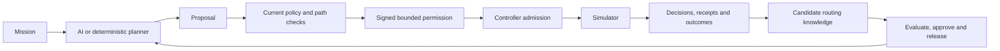

# Sovereign Autonomy

**Give robots a mission. Keep execution, learning and evidence under control.**

Sovereign Autonomy coordinates robot missions while keeping AI proposals separate
from permission to act. It combines mission planning, deterministic policy checks,
controller-enforced movement permits, operator oversight, governed routing knowledge
and verifiable decision records.

The operational environment is currently a **simulator**. An optional CPU skill lab
adds a small, measured manipulation-learning experiment. Neither constitutes
physical-robot validation or safety certification.

[Architecture](docs/architecture.md) · [Capability audit](docs/CAPABILITY_AUDIT.md) ·
[API](docs/api.md) · [Deployment](deploy/docker-compose.prod.yml) ·
[Hackathon provenance and evidence](docs/HACKATHON_SUBMISSION.md)

## What the platform does

| Area | Implemented behavior | Boundary |
| --- | --- | --- |
| Mission operations | Draft, assign, execute, pause, replan, replay and audit navigation missions | Simulated mobile carriers and humanoid navigation; no humanoid manipulation or balance control |
| Planning and perception | Configurable Meta planning, camera-informed proposals, object detections and stop-only voice input | Provider access and credentials required; fallback planning is labelled; voice depends on transcription |
| Execution governance | Site policies, full-path checks, signed expiring single-use permits, controller admission and revocation | Software control boundary; hardware adapters and site validation are separate work |
| Human control | Operator review, scoped stops, authenticated stop release and rule workflows | Approval does not override hard safety limits |
| Fleet routing knowledge | Automatic signed observation collection; evaluation, exact-version approval and release before historical runtime reuse | Bounded congestion advice, compatible site/map/policy/capability context; no automatic raw-memory baseline |
| Evidence and recovery | Hash-chained events, Ed25519 decision receipts, verification, interrupted-run reconciliation and signed backup tooling | Signing keys, controller journals and independent memory checkpoints must be protected and retained |
| Operational graph | Optional Memgraph index over reverified mission evidence; NetworkX computes routes | Planner history is restricted to released evidence; operator inspection remains separate |
| CPU skill lab | Expert demonstrations, affine behavior cloning, held-out physics evaluation, version release, compatible-recipient installation and single-use execution grants | Experimental Cartesian gripper task in MuJoCo; fixed task phases, measured coordinates and identical robot models; no real-world transfer claim |

The latest source tree and a running deployment can differ. The capability audit
separates recorded deployment evidence from later local changes; historical test
counts are not a guarantee about a new checkout.

## Control flow



Navigation and manipulation have separate execution contracts. Installing a skill
never starts it. The CPU lab uses its own artifact-bound grant and local controller;
it does not pretend a navigation `MOVE_TO` permit authorises joint manipulation.

## Repository

| Path | Purpose |
| --- | --- |
| `backend/app/` | FastAPI, mission runtime, governance, authority, learning and evidence |
| `backend/app/skills/` | Optional CPU physics, learned skill package and lab controller |
| `backend/bench/` | Navigation physics approximation, layouts and benchmark harness |
| `sim/warehouse_sim/` | Live navigation simulator and controller journal |
| `frontend/` | Next.js workspace, shared Three.js facility and skill-trace viewer |
| `frontend/public/home/` | Public homepage and recorded evidence assets |
| `deploy/` | HTTPS reverse proxy and production Compose configuration |
| `docs/` | Architecture, implementation scope, operations and validation |

## Local setup

Requirements: Docker with Compose, or Python 3.11+ and Node.js 20+ for native
work. Warehouse navigation does not require a dedicated GPU. The browser needs
WebGL for 3D views; low quality mode supports modest integrated graphics.

On a fresh clone, copy `.env.example` to `.env`. Preserve an existing environment
file. Set `PERMIT_SECRET` to a random secret of at least 32 characters before
starting the stack. Use the same value in the backend and simulator.

```sh
git clone https://github.com/othnielObasi/sovereign-autonomy.git
cd sovereign-autonomy
# Configure .env before the next command.
docker compose up -d --build
```

| Service | Local address |
| --- | --- |
| Workspace | http://localhost:3000/mission-control |
| Fleet learning | http://localhost:3000/learning |
| CPU skill lab | http://localhost:3000/skills |
| Backend health | http://localhost:8080/health |
| API documentation | http://localhost:8080/docs when enabled |

The root Compose file is for development: it publishes database/simulator ports
and runs the frontend development server. Use the production stack for hosting.
See [build instructions](docs/BUILD.md) for native multi-process development.

The simulator redeems movement permits with the backend. An unavailable admission
callback blocks new movement. Keep the controller journal across restarts.
Without model credentials, supported navigation uses the deterministic fallback;
policy checks and controller admission still apply.

## CPU skill-learning experiment

This is an optional laboratory, not a replacement warehouse or an Isaac dependency.
Install the extra in the environment running the backend:

```sh
python -m pip install -e './backend[skills]'
```

Set `SKILL_LAB_ENABLED=true` in that backend environment and restart that backend
when it is safe to do so. Sign in as an operator, then open `/skills`:

1. Collect twelve Robot A demonstrations and train a version on the CPU.
2. Evaluate six disjoint seeded positions with bounded payload/friction variation.
3. Inspect the results and no-grip ablation, then approve and release that digest.
4. Install the exact version on compatible Robot B. Incompatible Robot C is refused.
5. Request a short-lived grant and execute once in a fresh physics world.
6. Inspect measured lift, placement, contacts, controller limits and recorded traces.

The viewer replays recorded physics states after work completes; it is labelled
as replay. Continuous joint/gripper targets come from learned weights. The task's
phase scaffold is programmed and object coordinates are privileged simulation
state. This is not a vision policy or discovery of arbitrary motor skills.

For Compose, set `BACKEND_EXTRAS=postgres,skills` and `SKILL_LAB_ENABLED=true`
in the relevant environment file, then rebuild the backend. The lab runs a single
in-process CPU worker; train/evaluate/execute requests are bounded and operator-only.
Keep it disabled on deployments where its resource use has not been assessed.

[CPU lab design, API and validation](docs/CPU_SKILL_LAB.md) ·
[Routing-learning release boundary](docs/LEARNING_RELEASE_BOUNDARY.md)

## Production deployment

Use `deploy/docker-compose.prod.yml`: Caddy terminates HTTPS; the application,
Postgres, simulator and optional graph communicate over the private Compose network.
The frontend uses a production build. A single backend process is the supported
control-loop topology; multiple independent writers have not been validated.

Create the ignored `deploy/.env.production` with deployment-specific values:

| Variable | Purpose |
| --- | --- |
| `SITE_DOMAIN` | DNS hostname pointing to the host; ports 80/443 must be reachable |
| `ENVIRONMENT=production` | Enables production configuration validation |
| `JWT_SECRET`, `SIM_TOKEN`, `PERMIT_SECRET` | Independent random secrets; permit secret is shared with the simulator |
| `POSTGRES_PASSWORD` | Database password; use a URL-safe value for the provided connection URL |
| `AUTH_REQUIRED=true`, `ALLOW_DEV_TOKENS=false` | Enforce authenticated access; never expose development tokens |
| `AUTH_ACCOUNTS` | Password-hashed viewer/operator/admin accounts; generate using `scripts/add_account.py` |
| `RUN_MIGRATIONS_ON_START=true` | Apply the repository's Alembic migrations at startup |
| `SITE_LAYOUT=pharma` | Cleanroom layout; `warehouse` and `factory` are also available |
| `RECEIPT_SIGNING_KEY_FILE` | Persistent protected signing-key path, for example `/app/data/receipt-signing.key` |
| `SKILL_LAB_ENABLED=false` | Default: leave experimental CPU manipulation disabled |

Provider keys are optional and must stay out of git, screenshots and public assets.
Configure `MODEL_API_KEY` for supported Meta APIs, `BASETEN_API_KEY` for the optional
open-model path, `TAVILY_API_KEY` for lookup, and tracing keys only when needed.
Provider availability and costs depend on the account and region.

```sh
docker compose -f deploy/docker-compose.prod.yml --env-file deploy/.env.production up -d --build
docker compose -f deploy/docker-compose.prod.yml --env-file deploy/.env.production ps
```

Before exposing a deployment, verify health, operator sign-in, refusal of
unauthorised writes, controller admission, stop/reset behavior, evidence verification
and backup/restore on that deployment. A successful image build alone is insufficient.
The existing `deploy/deploy.sh` resets its server checkout to `origin/main`; review
that behavior before using it with local changes.

### Persistence and recovery

Persist Postgres, `backend_data`, `controller_data`, signing keys and memory anchors.
The optional skill lab stores its signed SQLite journal, independent checkpoint and
compressed training datasets under the backend authority-data directory. Back them
up together while protecting checkpoints independently against rollback.

Interrupted navigation runs reconcile before continuation. A consumed skill grant
cannot be replayed after a restart; interrupted manipulation must be inspected and
started again under fresh permission. Software stops do not replace safety-rated
hardware controls in a future physical deployment.

## Validation

Run backend tests from `backend` so the benchmark package resolves:

```sh
cd backend
python -m pytest tests -q
```

The CPU tests require the optional skills dependencies; real Memgraph integration
tests require an isolated `MEMGRAPH_TEST_URI`. Skips must be reported separately.

```sh
# From backend/
python -m pytest tests/test_cpu_skills.py -q
# From frontend/
npx tsc --noEmit --incremental false
npm run build
```

Run destructive operational drills only against an isolated simulator. Do not use
an active mission as a test fixture. Local validation does not update a running
public deployment.

## Further documentation

- [Architecture](docs/architecture.md) and [API reference](docs/api.md)
- [Capability audit](docs/CAPABILITY_AUDIT.md) and [safety case](docs/SAFETY_CASE.md)
- [Release-controlled route learning](docs/LEARNING_RELEASE_BOUNDARY.md)
- [Learning poisoning defenses](docs/LEARNING_POISONING_DEFENSES.md)
- [Memgraph setup and trust boundaries](docs/MEMGRAPH.md)
- [CPU skill lab](docs/CPU_SKILL_LAB.md)
- [Hackathon submission, prior foundation and recorded evidence](docs/HACKATHON_SUBMISSION.md)
- [Changelog](CHANGELOG.md)

## License

[MIT](LICENSE).
