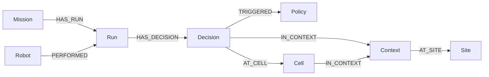

# Memgraph operational knowledge graph

Memgraph is an optional, derived graph of verified mission evidence. NetworkX
still computes routes, SQL still holds the source records, and execution
authority still independently governs dispatch. Graph history is advisory.

## What is connected



Cells are 0.5 m floor locations, not semantic corridors. Context contains the
exact site, map, policy and capability versions. The graph stores references and
structured observations, without model prompts, credentials or bulletin prose.

Use **Trust & security → Operational knowledge graph** (`/authority`) to choose a
finished run, sync evidence and expand its verified connections. The panel shows
robot/location, decision/policy and source event/receipt IDs. The history API can
also find observations near a coordinate in an exact compatible context and
return policy counts for the bounded sample.

## Configure

Install backend dependencies, including the Neo4j Python Bolt driver:

```powershell
.\.venv\Scripts\python.exe -m pip install -e ./backend
```

For a backend running on the host, put these settings in `backend/.env`:

```dotenv
MEMGRAPH_ENABLED=true
MEMGRAPH_URI=bolt://127.0.0.1:7687
MEMGRAPH_NAMESPACE=sovereign-autonomy
MEMGRAPH_USERNAME=
MEMGRAPH_PASSWORD=
MEMGRAPH_SYNC_INTERVAL_S=30
```

Start the optional local database with Docker Compose:

```powershell
docker compose --profile graph up -d memgraph
```

For a Compose backend, also set `MEMGRAPH_ENABLED=true` in the root `.env` and
recreate the backend. Compose points it to `bolt://memgraph:7687`. Root and
backend env files are separate configurations. The local graph profile publishes
Bolt only on host loopback and persists data in `memgraph_data`. It has no users
by default. Remote deployments must configure database authentication and TLS;
the application supports Bolt credentials and encrypted Bolt URIs. Use a distinct
namespace per deployment. Namespaces separate application queries; they are not
database access controls or a multi-tenant security boundary.

Restart the backend after changing settings. Disabled, connected and unavailable
are distinct API/UI states. No credentials are returned in status/error bodies.

## Ingestion and source verification

Every 30 seconds by default, a background worker projects the latest 20 terminal
runs (completed, stopped, failed or failed_safety). Older runs can be synced by
ID. Runs over 10,000 events are refused. Active runs are not projected. There is
no historical backfill cursor in this first integration.

The source run's original event contents and hash links must verify. A decision
must also have a valid Ed25519-signed SQL record linked to its event hash, with
matching proposal/verdict/policy hits and complete signed experience context.
Unsigned legacy decisions are excluded. The derived snapshot fingerprint makes
sync idempotent; changed eligible decisions are replaced atomically per run.
Projection writes are serialized in this single backend process. Multiple graph
writers and high-availability operation have not been validated.

Every history read reconstructs facts from SQL and rechecks the chain,
signatures, event hash, requested context/location/run, and configured experience
TTL. Freshness uses the signed decision timestamp. A changed, deleted, expired
or unverifiable source is excluded even when a graph reference remains. Raw graph
counts describe stored references, including references that may later be
excluded. Old cell/context/policy nodes may remain after replacement.

This detects tampering under the existing signing-key trust model; it does not
prove sensor truth or stop a fully privileged deployment administrator from
altering all trust anchors. Graph omission can reduce available history. Graph
facts do not change route-learning corroboration requirements or NetworkX costs.

## Planner integration

Muse mission planning and the agentic planner retrieve up to ten nearby verified
observations in the exact current site/map/policy/capability context. Muse plans
record the retrieval state and offered source event IDs in `graph_history`.
This records offered evidence, not proof that a model used it correctly. Current
telemetry, task checks, deterministic policy and permits continue to govern the
result. A graph outage or unknown context supplies no historical facts.

The graph is a retrieval index over decision evidence. It does not yet project
learned lesson entities, facility dependency/closure relationships or semantic
corridors; it does not train models or automatically optimize routing weights.

## API

| Endpoint | Purpose | Access |
| --- | --- | --- |
| `GET /knowledge/status` | Probe actual connectivity and projection counts | Viewer; development follows existing read-access convention |
| `POST /knowledge/sync` | Project latest 20 terminal runs | Signed-in operator/admin, including development |
| `POST /knowledge/runs/{id}/sync` | Project one terminal run | Signed-in operator/admin |
| `GET /knowledge/runs/{id}?limit=30` | Reverified run connections | Viewer |
| `POST /knowledge/history` | Exact-context nearby history and policy counts | Viewer |

History body: `context` with all four fields, numeric `x`/`y`, optional `radius`
(0–10 m) and `limit` (1–50). Queries are fixed and parameterized. There is no raw
Cypher endpoint. Unavailable graph reads return 503; rejected source syncs return
409. A source rejected during a recent-run batch is reported individually.

## Validation

```powershell
$env:MEMGRAPH_TEST_URI='bolt://127.0.0.1:7687'
Set-Location backend
..\.venv\Scripts\python.exe -m pytest tests/test_operational_graph.py -q
```

Tests use random graph namespaces and remove only those namespaces. Ordinary
tests disable Memgraph regardless of backend env configuration. Real integration
cases explicitly opt in with `MEMGRAPH_TEST_URI`; no model calls are required.
Browser acceptance: `node tests/operational-graph.browser.cjs` against the isolated
stack containing the verified reference run. Screenshots and API evidence are in
`docs/validation/2026-11-03-memgraph`.

On this Windows host, Docker was unavailable. Memgraph 3.14.0 was extracted into
`/opt/sovereign-memgraph` under the existing Ubuntu WSL distribution and launched
on loopback port 17687. A runtime-local `libpython3.so` symlink points to Ubuntu's
Python 3.14 shared library. This is a local validation setup, not a packaged
deployment or a system startup service. Compose remains the reproducible
deployment path; an actual Docker image launch was not tested here.

For subsequent local sessions on this prepared host, run
`powershell -File scripts/start_memgraph_wsl.ps1` and set the host backend URI to
`bolt://127.0.0.1:17687`. The helper runs in the foreground and stops with Ctrl+C.

Official references: [Python/Bolt client](https://memgraph.com/docs/client-libraries/python),
[installation options](https://memgraph.com/docs/getting-started/install-memgraph),
[3.14.0 package](https://memgraph.com/docs/getting-started/install-memgraph/direct-download-links).
